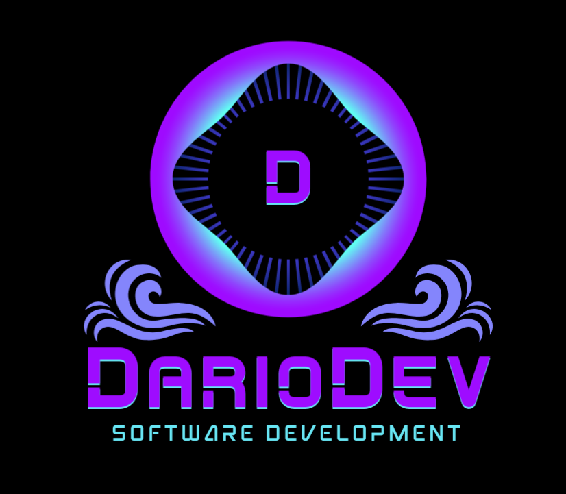

  
  

    
    
  

<table>
<tr>

<td width="50%" valign="top">

# About Me

I'm a 4th-year Computer Science student passionate about software development, Artificial Intelligence and problem solving.

I enjoy building practical solutions, learning new technologies and tackling challenging algorithmic problems.

## What I Do

### 🤖 AI & ML

I'm interested in **AI and Machine Learning**, exploring how intelligent systems can be developed to solve real-world problems.

### 🧠 Algorithms

I enjoy competitive programming and solving problems involving **advanced data structures, algorithms, mathematics, and optimization**.

### Full-Stack

Although backend is my main focus, I also have experience with **React and Streamlit** for building interfaces and interactive applications.

</td>

<td width="50%" valign="top">

# 🛠️ Skills

* **Problem Solving**
* **Design & Analysis of Algorithms**
* **Backend Architecture**
* **Machine Learning**

# ⚙️ Tech Stack

### Languages

### Backend

### Frontend

### AI & ML

### Tools & Environment

</td>

</tr>
</table>

---

# Featured Projects

<table>
<tr>

<td width="50%" valign="top">

### AutoDash

Create functional Streamlit dashboards using only natural language.

**Stack:**
`Python` `Streamlit` `AI_Agents` `LLMs`

[→ View Repository](https://github.com/DarioDev01/AutoDash)

</td>

<td width="50%" valign="top">

### EDA_Bank

Collection of Data Structures and Algorithms in C++.

**Stack:**
`C++` `EDA` `DAA`

[→ View Repository](https://github.com/DarioDev01/EDA_Bank)

</td>

</tr>

<tr>

<td width="50%" valign="top">

### 🔐 SafeKey

Chrome extension designed to catch and block accidental API key leaks before you hit send.

**Stack:**
`CSS` `HTML` `JavaScript` `Chrome Extension`

[→ View Repository](https://github.com/DarioDev01/SafeKey)

</td>

<td width="50%" valign="top">

### 🔮 More Coming Soon

I'm continuously working on new ideas and projects to expand my skills, explore new technologies, and build a stronger portfolio.

</td>

</tr>
</table>

# GitHub Analytics

 
  

    
  

  <!-- 

    
  
 -->
 

  
  
  
  "Always learning. Always building. Always improving."

